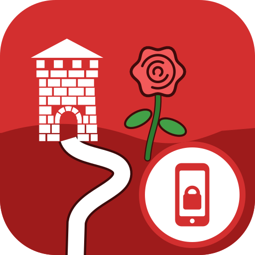

<h1 align="center">Rosenweg Gerät</h1>

Geräteverwaltung der geteilten Rosenweg-Smartphones: Anmelden per Karte, Rosenweg-Apps, Zugänge der Person – und die Nebenstelle an der Telefonanlage.

<a href="https://www.rosenweg4303.ch/smartphones">Geteilte Telefone</a> · <a href="docs/anleitung.md">Anleitung</a> · <a href="docs/entwickeln.md">Für Entwickler</a>

## Was die App kann

- Sperrt das Telefon, bis sich jemand anmeldet – per NFC-Karte, QR-Code oder Rosenweg-Konto.
- Beim Abmelden werden persönliche Daten gelöscht, erst nachdem alles hochgeladen ist.
- Installiert und aktualisiert die Rosenweg-Apps aus dem Katalog der Telefonanlage.
- Gibt den Apps die Zugänge der angemeldeten Person (Nextcloud, Telefonnummer, Messenger).
- Nebenstelle des Telefons, Telefonbuch der Siedlung, „Telefon suchen“.

## Plattformen

Android, nur auf den geteilten Rosenweg-Telefonen (Device Owner, Einrichtung durch die Technik).

## Entwickeln

Android-App (Java, Gradle, NDK für die Codecs).
Bau, Schnittstellen, Signatur und Veröffentlichung stehen in [docs/entwickeln.md](docs/entwickeln.md).

## Herkunft und Lizenz

Basiert auf [Android SIP](https://github.com/hell3lazer/Android-SIP), einer modernisierten Fassung von [Sipdroid](https://github.com/i-p-tel/sipdroid) – herzlichen Dank an die Sipdroid-Entwickler und den Autor von Android SIP.
GPL-3.0, siehe [LICENSE.TXT](LICENSE.TXT), mit den zusätzlichen Bedingungen von Sipdroid in [ADDITIONAL_TERMS.txt](ADDITIONAL_TERMS.txt).
